<h1 align="center">Fábrica do TaskInput</h1>

<p align="center">
  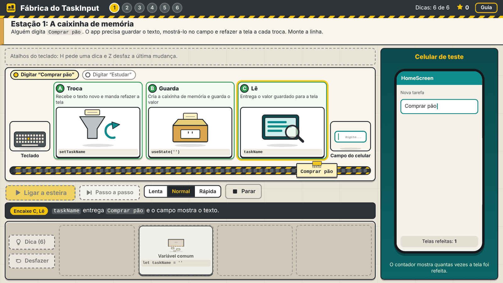
</p>

<p align="center">
  <b>Monte a linha de produção, ligue a esteira e veja o celular reagir.</b><br>
  Um jogo educativo que ensina o componente <code>TaskInput</code> do React Native sem perguntas de múltipla escolha.
</p>

<p align="center">
  
  
  
  
  
  
</p>

<p align="center">
  <a href="#sobre">Sobre</a> ·
  <a href="#veja-funcionando">Veja funcionando</a> ·
  <a href="#o-que-o-jogo-ensina">O que ensina</a> ·
  <a href="#como-se-joga">Como se joga</a> ·
  <a href="#as-seis-estações">As seis estações</a> ·
  <a href="#como-executar">Como executar</a> ·
  <a href="#para-quem-conduz-a-atividade">Para quem conduz</a> ·
  <a href="#como-personalizar">Como personalizar</a> ·
  <a href="#testes-e-qualidade">Testes</a>
</p>

---

## Sobre

A **Fábrica do TaskInput** troca perguntas e respostas por uma linha de produção. O texto que a pessoa digita vira um **bilhete** que viaja por uma **esteira**. Cada trecho de código é uma **máquina** desenhada, e quem joga precisa encaixar as máquinas certas, na ordem certa, para o bilhete chegar ao celular de teste do jeito que o pedido da estação manda.

Quando a linha está errada, a esteira não dá só um "errou". Ela mostra **qual máquina falhou** e uma janela explica **o que o código realmente faz**. Em cada estação existe uma peça que parece certa e não é, justamente para o erro acontecer, ser visto e ser entendido.

O conteúdo gira em torno de um componente real: o campo de **Nova tarefa** de um app de lista de tarefas em React Native com TypeScript. São seis estações, do `useState` até a montagem dos dois arquivos com `export` e `import`.

| Em números | |
|---|---|
| Estações | 6 |
| Peças no total | 26 (19 certas, 1 alternativa e 6 armadilhas) |
| Máquinas desenhadas em SVG | 34 |
| Pacotes de teste | 14 |
| Fichas de conceito | 32 |
| Montagens verificadas por script | 324 |
| Dependências | 0 |
| Tamanho dos arquivos do jogo | cerca de 200 KB |

Funciona **offline**, abre com um duplo clique em `index.html`, não faz nenhuma requisição externa e não grava nada no navegador.

---

## Veja funcionando

<p align="center">
  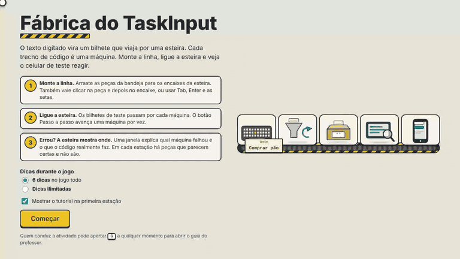
</p>

<p align="center"><sub>Uma partida na estação 1: a peça que engana derruba a esteira, a janela explica o motivo, a peça é desfeita e trocada, e os dois bilhetes chegam ao celular.</sub></p>

<p align="center">
  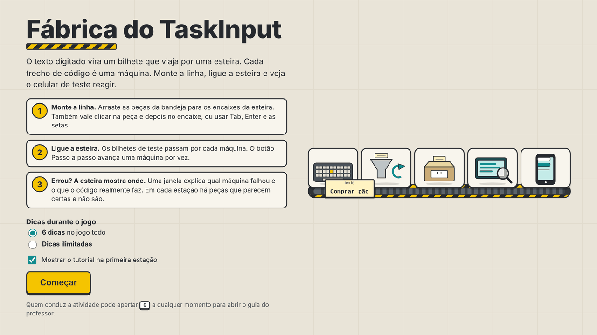
</p>

---

## O que o jogo ensina

Cada estação fixa um grupo de conceitos do componente `TaskInput` e tem uma peça que engana.

| # | Estação | Conceitos | A peça que engana |
|---|---|---|---|
| 1 | A caixinha de memória | Estado com `useState('')`: o valor guardado (`taskName`) e a função que o troca (`setTaskName`) | `let taskName = ''` muda por dentro, mas a tela não é refeita |
| 2 | Os dois fios do campo | Campo controlado: `onChangeText` leva cada tecla ao estado, `value` traz o estado de volta, `placeholder` mostra o exemplo | `defaultValue` só vale no começo e o campo não é limpo depois |
| 3 | O botão que escuta o toque | `TouchableOpacity` e `onPress={handleAddTask}`, passando a função em vez de chamá-la | `onPress={handleAddTask()}` roda ao abrir a tela, e não no toque |
| 4 | Os alertas na tela | `Alert.alert` de erro e de confirmação; sem o terceiro argumento o botão OK vem sozinho | `Alert.alert` na versão web (`react-native-web`) é uma função vazia: nenhuma caixa aparece |
| 5 | O porteiro da validação | `trim()`, `if (!trimmedName)`, cláusula de guarda com `return` e `setTaskName('')` | `replace(/\s/g, '')` tira também o espaço do meio do texto |
| 6 | A montagem dos dois arquivos | `React.FC` sem props, `export const`, `import { }` e o uso de `<TaskInput />` em outro arquivo | `export default` muda a forma de importar |

---

## Como se joga

1. **Monte a linha.** Arraste as peças da bandeja para os encaixes da esteira. Também vale clicar na peça e depois no encaixe, ou usar <kbd>Tab</kbd>, <kbd>Enter</kbd> e as setas.
2. **Ligue a esteira.** Os bilhetes de teste passam por cada máquina. O botão **Passo a passo** avança uma máquina por vez, com uma legenda que explica o que acabou de acontecer.
3. **Errou? A esteira mostra onde.** Uma janela explica qual máquina falhou e o que o código realmente faz. Depois do **OK** a montagem continua na tela, com o encaixe suspeito marcado, e dá para desfazer ou trocar a peça.

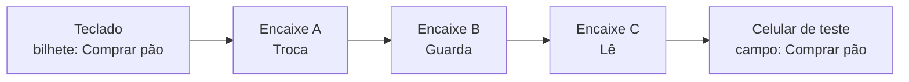

O ciclo de cada estação:

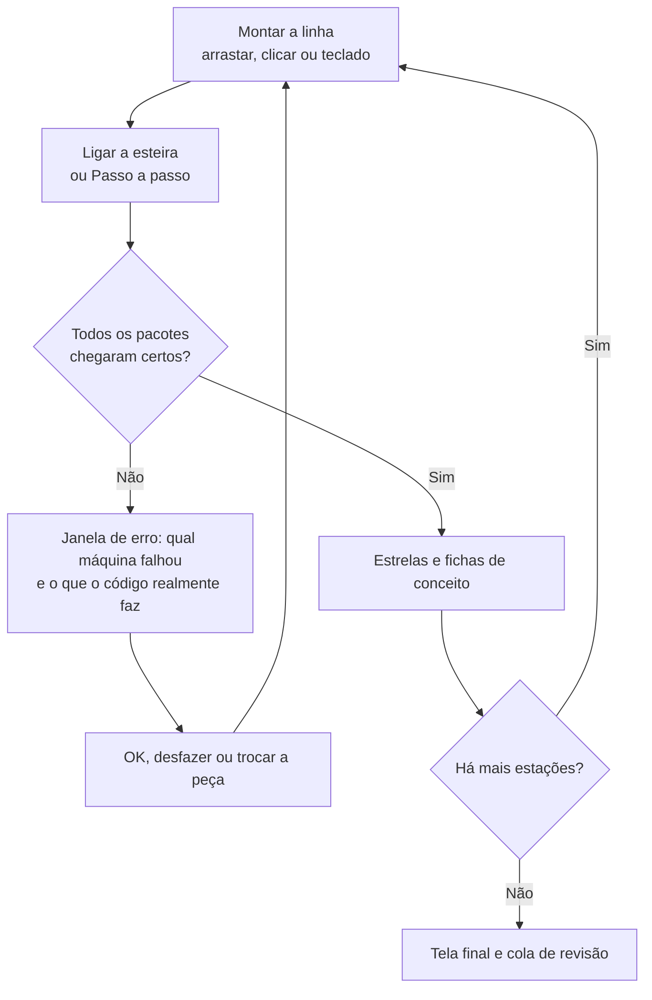

---

## As seis estações

Cada estação traz um pedido, de três a quatro encaixes e dois ou três pacotes de teste. Abaixo, a bandeja de cada uma começa cheia e a esteira começa vazia. Os gabaritos ficam recolhidos para não estragar a surpresa de quem só está olhando o repositório.

### Estação 1: A caixinha de memória

> Alguém digita `Comprar pão`. O app precisa guardar o texto, mostrá-lo no campo e refazer a tela a cada troca. Monte a linha.

**Pacotes de teste:** Digitar “Comprar pão” e Digitar “Estudar”.

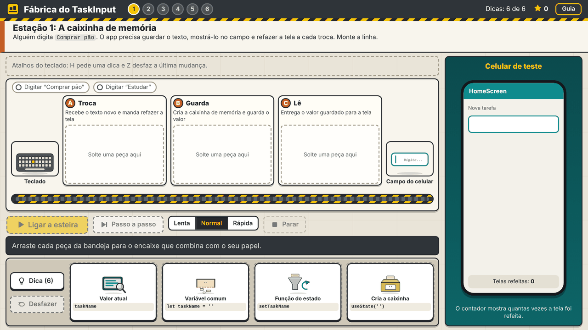

<details>
<summary>Ver o gabarito e a peça que engana</summary>

| Encaixe | Papel | Peça certa |
|---|---|---|
| A, Troca | Recebe o texto novo e manda refazer a tela | `setTaskName` |
| B, Guarda | Cria a caixinha de memória e guarda o valor | `useState('')` |
| C, Lê | Entrega o valor guardado para a tela | `taskName` |

**Peça que engana:** `let taskName = ''`. A variável muda por dentro, mas o React não fica sabendo, então a tela continua igual.

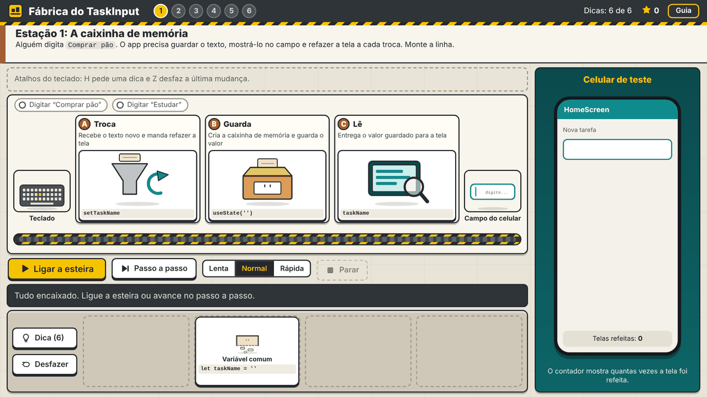

</details>

### Estação 2: Os dois fios do campo

> O campo precisa mostrar o que a pessoa digita. Cada tecla deve ir para o estado, o estado deve voltar ao campo e o campo vazio precisa de um texto de orientação.

**Pacotes de teste:** Digitar “Comprar pão” e Estado volta a vazio.

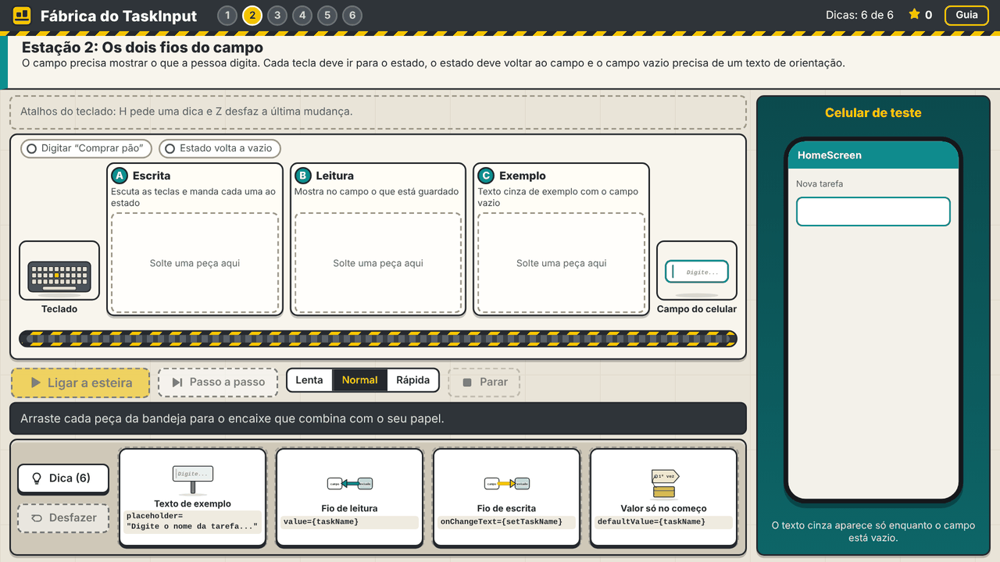

<details>
<summary>Ver o gabarito e a peça que engana</summary>

| Encaixe | Papel | Peça certa |
|---|---|---|
| A, Escrita | Escuta as teclas e manda cada uma ao estado | `onChangeText={setTaskName}` |
| B, Leitura | Mostra no campo o que está guardado | `value={taskName}` |
| C, Exemplo | Texto cinza de exemplo com o campo vazio | `placeholder="Digite o nome da tarefa..."` |

**Peça que engana:** `defaultValue={taskName}`. Aceita digitar, mas só lê o valor no começo. Quando o estado volta a vazio, o texto do campo não é limpo.

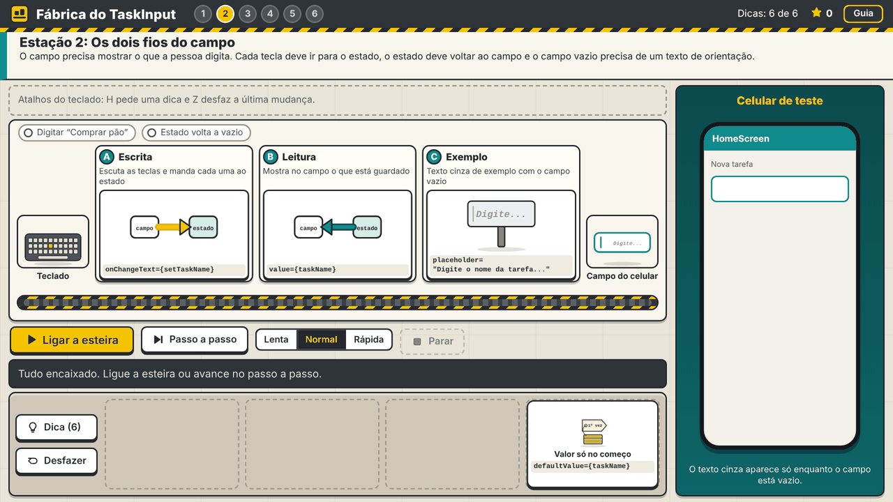

</details>

### Estação 3: O botão que escuta o toque

> A função `handleAddTask` deve rodar só quando o dedo toca no botão, nunca ao abrir a tela, e o botão precisa esmaecer enquanto é apertado.

**Pacotes de teste:** Abrir a tela e Tocar com “Comprar pão”.

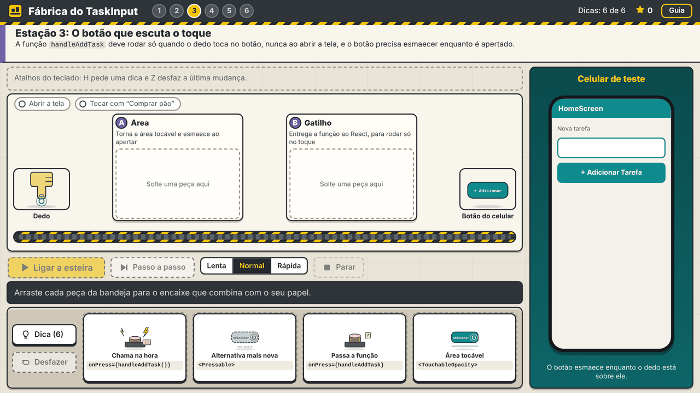

<details>
<summary>Ver o gabarito, a alternativa e a peça que engana</summary>

| Encaixe | Papel | Peça certa |
|---|---|---|
| A, Área | Torna a área tocável e esmaece ao apertar | `<TouchableOpacity>` |
| B, Gatilho | Entrega a função ao React, para rodar só no toque | `onPress={handleAddTask}` |

**Peça alternativa:** `<Pressable>` é a opção mais nova e recebe o toque, mas sem estilo ela não esmaece. O efeito de apertar passa a ser responsabilidade de quem programa.

**Peça que engana:** `onPress={handleAddTask()}`. Os parênteses chamam a função na hora, então o alerta de erro aparece assim que a tela abre.

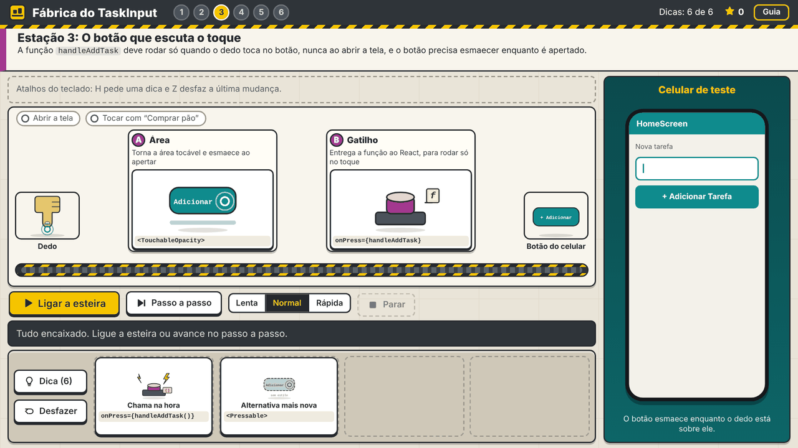

</details>

### Estação 4: Os alertas na tela

> Tocar com o campo vazio deve mostrar um aviso de erro. Tocar com texto deve mostrar o texto de volta. A pessoa fecha a caixa no botão OK. Tem que funcionar no celular.

**Pacotes de teste:** Tocar com o campo vazio, Tocar com “Comprar pão” e Teste no navegador (só observação).

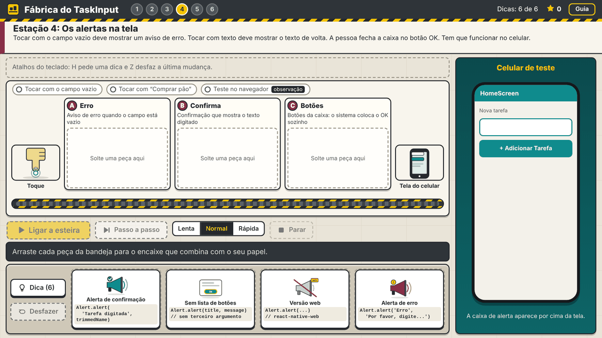

<details>
<summary>Ver o gabarito e a peça que engana</summary>

| Encaixe | Papel | Peça certa |
|---|---|---|
| A, Erro | Aviso de erro quando o campo está vazio | `Alert.alert('Erro', 'Por favor, digite...')` |
| B, Confirma | Confirmação que mostra o texto digitado | `Alert.alert('Tarefa digitada', trimmedName)` |
| C, Botões | Botões da caixa: o sistema coloca o OK sozinho | `Alert.alert(title, message)`, sem terceiro argumento |

**Peça que engana:** `Alert.alert(...)` na versão web. No `react-native-web` a função é vazia e nenhuma caixa aparece, então o teste no navegador não mostra a caixa. É preciso testar também no celular ou no emulador.

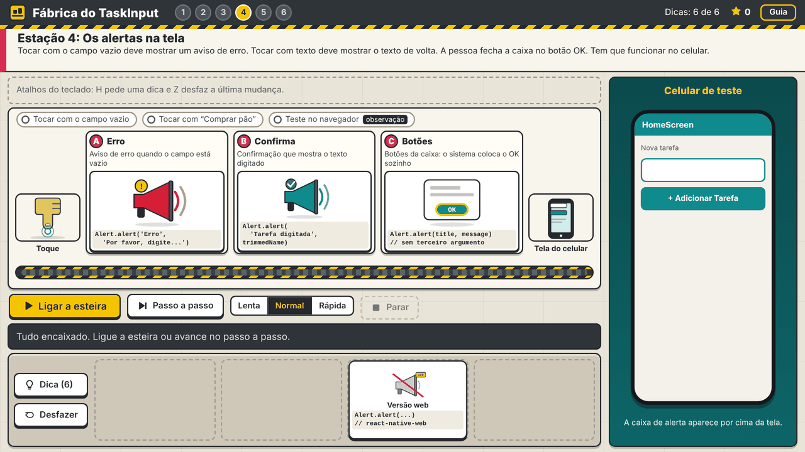

</details>

### Estação 5: O porteiro da validação

> Antes de aceitar uma tarefa, o porteiro confere o texto. Texto válido: confirma e limpa o campo. Texto só com espaços: avisa o erro e não limpa o campo. Os espaços das pontas não contam, mas o do meio fica.

**Pacotes de teste:** Tocar com “Comprar pão”, Tocar com só espaços e Tocar com “Estudar” cercado de espaços. Nesta estação os espaços das pontas aparecem como pontinhos (`·`) para dar para ver.

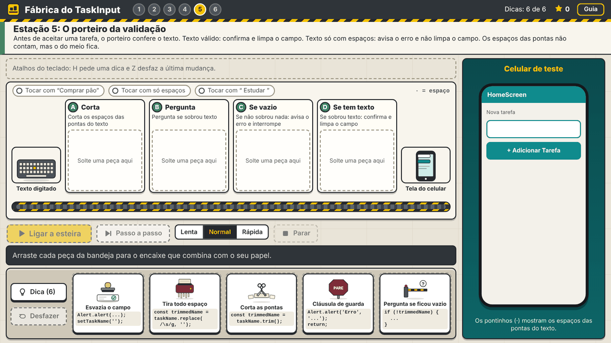

<details>
<summary>Ver o gabarito e a peça que engana</summary>

| Encaixe | Papel | Peça certa |
|---|---|---|
| A, Corta | Corta os espaços das pontas do texto | `const trimmedName = taskName.trim();` |
| B, Pergunta | Pergunta se sobrou texto | `if (!trimmedName) { ... }` |
| C, Se vazio | Se não sobrou nada: avisa o erro e interrompe | `Alert.alert('Erro', '...'); return;` |
| D, Se tem texto | Se sobrou texto: confirma e limpa o campo | `Alert.alert(...); setTaskName('');` |

**Peça que engana:** `const trimmedName = taskName.replace(/\s/g, '');`. Ela tira o espaço do meio também, e “Comprar pão” vira “Comprarpão”. O `trim()` só mexe nas pontas, e é isso que o pedido quer.

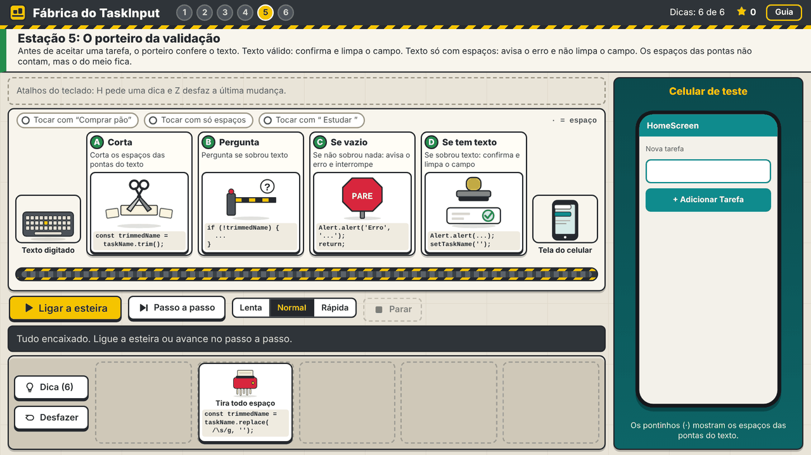

</details>

### Estação 6: A montagem dos dois arquivos

> O componente nasce em `TaskInput.tsx` e precisa aparecer na `HomeScreen.tsx`. Ele não deve aceitar props de fora. O caminhão leva o componente de um arquivo ao outro.

**Pacotes de teste:** Abrir a HomeScreen e Passar `nome="x"` (o TypeScript precisa recusar).

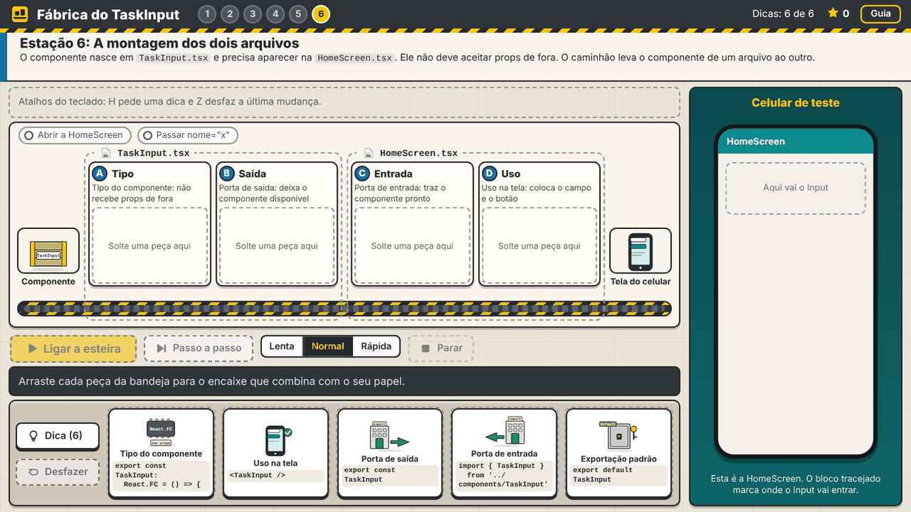

<details>
<summary>Ver o gabarito e a peça que engana</summary>

| Arquivo | Encaixe | Papel | Peça certa |
|---|---|---|---|
| `TaskInput.tsx` | A, Tipo | Tipo do componente: não recebe props de fora | `export const TaskInput: React.FC = () => {` |
| `TaskInput.tsx` | B, Saída | Porta de saída: deixa o componente disponível | `export const TaskInput` |
| `HomeScreen.tsx` | C, Entrada | Porta de entrada: traz o componente pronto | `import { TaskInput } from '../components/TaskInput'` |
| `HomeScreen.tsx` | D, Uso | Uso na tela: coloca o campo e o botão | `<TaskInput />` |

**Peça que engana:** `export default TaskInput`. Exportar como padrão muda a forma de importar: a chave `{ TaskInput }` deixa de funcionar.

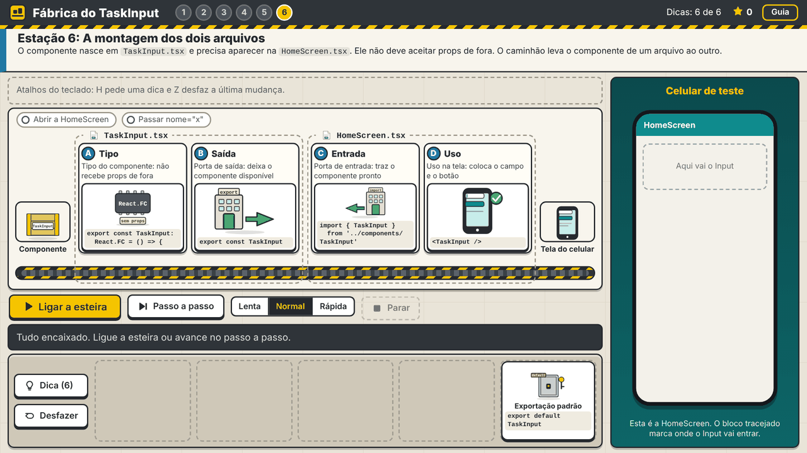

</details>

### Catálogo de máquinas

As 34 ilustrações são desenhos SVG escritos no próprio código, todos no mesmo estilo: contorno escuro, cores chapadas e paleta de chão de fábrica. Parte delas se mexe quando o encaixe está ativo.

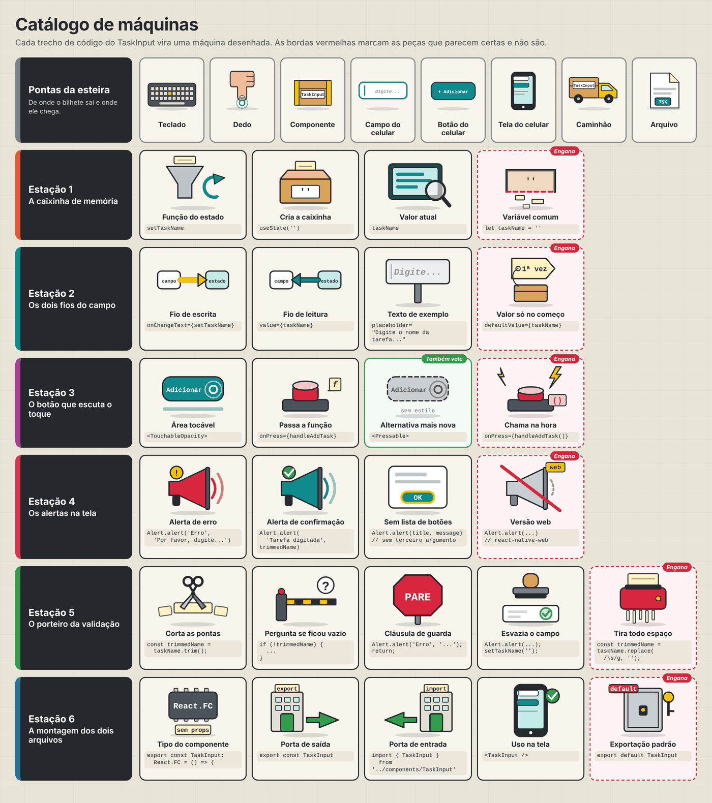

---

## Por que uma esteira

- **O erro é parte do jogo.** Toda estação tem uma peça que engana. Errar custa pouco (só reduz as estrelas daquela estação) e rende uma explicação concreta.
- **Cada código é um objeto.** Uma tesoura que corta as pontas, uma cancela que faz uma pergunta, um carimbo que limpa o campo. A imagem dá um apoio para lembrar o que a linha de código faz.
- **O celular de teste é a prova.** O resultado não vem de uma resposta marcada, mas do campo do celular na tela: o texto aparece, o contador de telas refeitas sobe, o botão esmaece, o alerta abre.
- **Sem cronômetro.** A atividade é para pensar, discutir e comparar. Quem conduz decide o ritmo.
- **A dica é graduada.** A primeira pista pergunta, a segunda entrega mais detalhes e destaca a peça certa. Ninguém fica travado, e as dicas são contadas.

---

## Recursos

**Montagem**
- Arrastar e soltar, clicar na peça e depois no encaixe, ou teclado completo.
- Desfazer a última mudança, devolver uma peça ao tocar no encaixe cheio.
- Estações com encaixes agrupados em arquivos (estação 6).

**Esteira**
- **Ligar a esteira** roda todos os pacotes de teste. **Passo a passo** avança uma máquina por vez. **Parar** interrompe.
- Três velocidades: Lenta, Normal e Rápida.
- Legenda didática a cada passo e celular de teste que reage ao vivo.

<table>
  <tr>
    <td width="50%">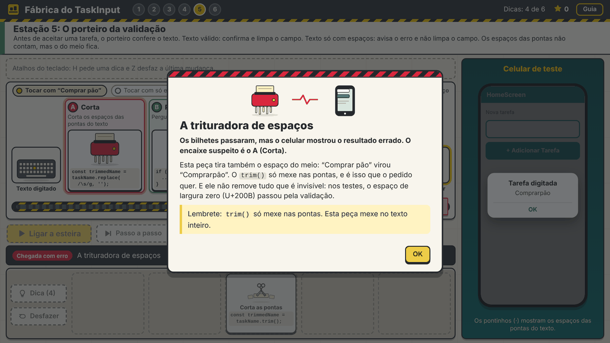<br><sub><b>Janela de erro:</b> diz qual máquina falhou, mostra o resultado errado no celular e fecha no botão OK.</sub></td>
    <td width="50%">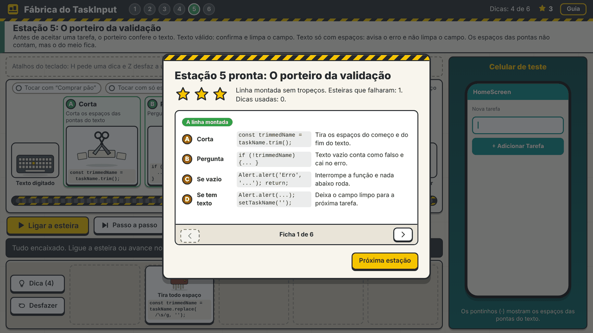<br><sub><b>Estação pronta:</b> estrelas, resumo da esteira e fichas de conceito para folhear.</sub></td>
  </tr>
  <tr>
    <td width="50%">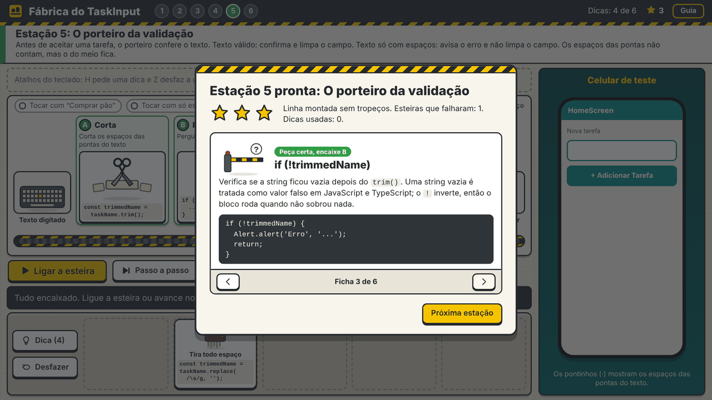<br><sub><b>Fichas de conceito:</b> uma por encaixe e uma para cada peça que engana, com o código ao lado da explicação.</sub></td>
    <td width="50%">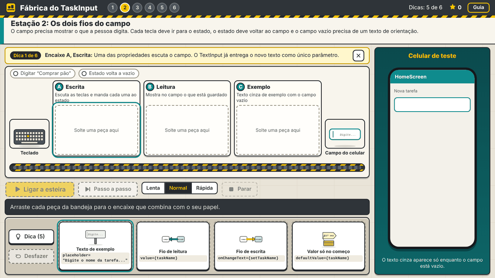<br><sub><b>Dicas:</b> aparecem em uma faixa e destacam o encaixe. Podem ser limitadas a 6 no jogo todo ou ilimitadas.</sub></td>
  </tr>
  <tr>
    <td width="50%"><br><sub><b>Tutorial:</b> sete passos curtos na estação 1, com as dicas liberadas. Dá para pular.</sub></td>
    <td width="50%">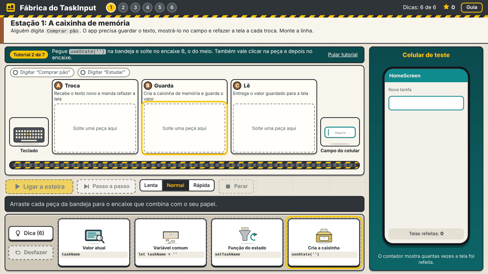<br><sub>O tutorial destaca a peça e o encaixe da vez e só libera a ação que ele pede.</sub></td>
  </tr>
</table>

**Fixação**
- Ficha de conceito para cada encaixe e para cada peça que engana (de 5 a 6 por estação).
- Estrelas por estação e tela final com a tabela de resultados.
- **Cola de revisão** imprimível: o que cada código faz e os cuidados, em duas páginas A4.

**Para quem conduz**
- **Guia do professor** na tecla <kbd>G</kbd>, a qualquer momento: objetivo, como conduzir, gabarito, atenções e perguntas para a discussão.
- Atalhos para ir direto a qualquer estação.

**Telas e acessibilidade**
- Desenho-base de 1280 por 720 que se amplia até 2560 por 1440 sem rolagem.
- Layout vertical para telas estreitas (celular e tablet), com toque.
- Foco visível, anúncios para leitores de tela e respeito a `prefers-reduced-motion`.

---

## Como executar

**Pelo navegador, sem instalar nada**

1. Baixe o repositório em **Code > Download ZIP** e extraia a pasta.
2. Dê um duplo clique em `index.html`.

Não precisa de servidor, de internet nem de build. Os scripts são clássicos (variáveis em `window`), por isso funcionam também abertos direto do disco.

**Para publicar com o GitHub Pages**

No repositório, abra **Settings > Pages**, escolha **Deploy from a branch**, selecione a branch principal e a pasta `/ (root)`. Em alguns minutos o endereço aparece nessa mesma página.

**Para projetar em sala**

Use a tela cheia do navegador (<kbd>F11</kbd>). O jogo se ajusta a projetores de 1280 por 720 ou maiores.

**Navegadores**

O jogo foi desenvolvido e testado no Chromium (base do Chrome e do Edge). Ele usa só recursos padrão (CSS Grid, flexbox, variáveis CSS, SVG embutido), mas Firefox e Safari não foram testados.

---

## Controles e atalhos

| Ação | Como fazer |
|---|---|
| Colocar uma peça | Arrastar até o encaixe, ou clicar na peça e depois no encaixe, ou <kbd>Enter</kbd> ou <kbd>Espaço</kbd> na peça e depois no encaixe |
| Navegar entre peças e encaixes | <kbd>Tab</kbd> e <kbd>Shift</kbd>+<kbd>Tab</kbd>; as setas movem entre as peças, entre os encaixes e de uma fileira para a outra |
| Devolver uma peça à bandeja | Clicar no encaixe cheio, ou <kbd>Delete</kbd> ou <kbd>Backspace</kbd> com o encaixe em foco |
| Pedir uma dica | <kbd>H</kbd> ou o botão **Dica** |
| Desfazer a última mudança | <kbd>Z</kbd> ou o botão **Desfazer** |
| Abrir o guia do professor | <kbd>G</kbd> ou o botão **Guia** |
| Cancelar a seleção ou fechar a janela | <kbd>Esc</kbd> |

Os atalhos de letra não funcionam com <kbd>Ctrl</kbd>, <kbd>Alt</kbd> ou <kbd>Cmd</kbd> pressionados nem enquanto se digita em um campo. Com uma janela aberta, <kbd>H</kbd> e <kbd>Z</kbd> ficam desativados.

---

## Pontuação

Cada estação vale de uma a três estrelas, conforme a soma de **esteiras que falharam** com **dicas usadas** naquela estação.

| Esteiras que falharam + dicas usadas | Estrelas |
|---|---|
| 0 ou 1 | 3 |
| de 2 a 4 | 2 |
| 5 ou mais | 1 |

- Em cada encaixe, a primeira e a segunda dica contam. Pedir uma terceira vez repete a dica forte sem custo.
- As dicas do tutorial são gratuitas.
- Uma esteira que falha **nunca tira** nada do jogo: só pesa nas estrelas.
- Na tela final, a média das seis estações define as estrelas grandes: 3 estrelas com média a partir de 2,5; 2 estrelas a partir de 1,75; 1 estrela abaixo disso.

<p align="center">
  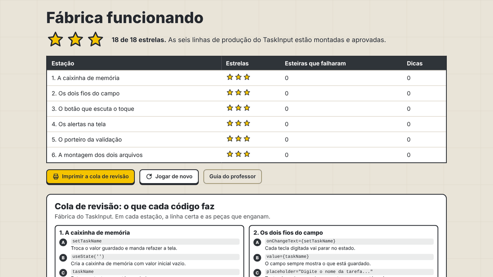
</p>

---

## Para quem conduz a atividade

Aperte <kbd>G</kbd> em qualquer momento para abrir o **guia do professor**. Ele traz o objetivo, sugestões de condução, o gabarito completo com um botão **Ir para esta estação** e perguntas para a discussão.

<p align="center">
  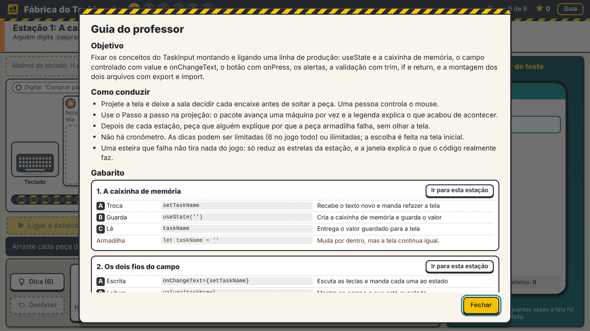
</p>

**Sugestão de condução**

- Projete a tela e deixe a sala decidir cada encaixe antes de soltar a peça. Uma pessoa controla o mouse.
- Use o **Passo a passo** na projeção: o bilhete avança uma máquina por vez e a legenda explica o que acabou de acontecer.
- Depois de cada estação, peça que alguém explique por que a peça que engana falha, sem olhar a tela.
- Não há cronômetro. As dicas podem ser limitadas ou ilimitadas, e a escolha é feita na tela inicial.

**Perguntas para a discussão**

1. O que muda se trocarmos `value` por `defaultValue`? Teste montando a estação 2 com a peça que engana.
2. Por que `onPress={handleAddTask()}` mostra o alerta de erro assim que a tela abre?
3. Se retirarmos o `return` do porteiro, o que a pessoa vê quando toca com o campo vazio?
4. Por que o texto “Comprar pão” continua com o espaço do meio depois do `trim()`?

**Cola de revisão**

Na tela final, o botão **Imprimir a cola de revisão** abre a impressão só com a cola, em duas páginas A4: para cada estação, a linha certa e as peças que enganam.

<p align="center">
  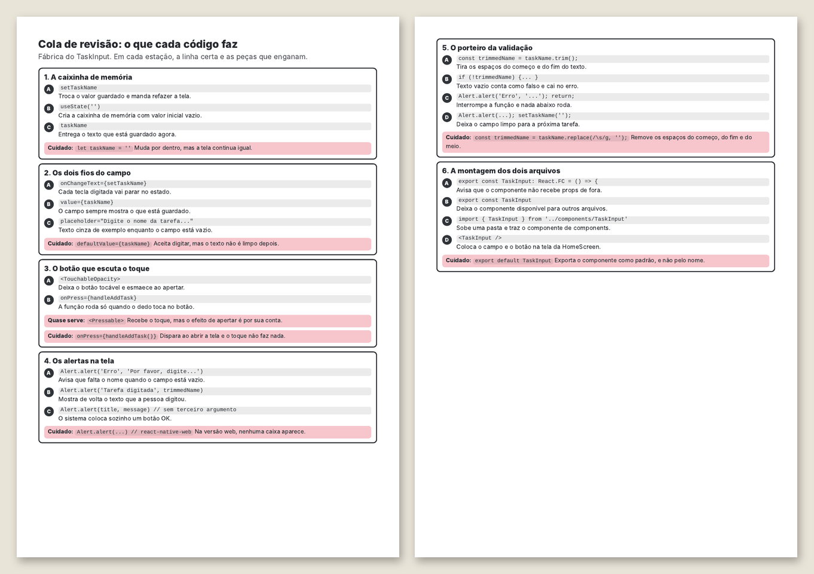
</p>

---

## Acessibilidade e telas

- **Teclado:** toda a montagem, a esteira, as dicas, as janelas e o guia funcionam sem mouse. O foco é visível e fica preso dentro das janelas abertas.
- **Leitores de tela:** a legenda da esteira, as dicas e as mensagens de estado são anunciadas por regiões `aria-live`.
- **Movimento reduzido:** com `prefers-reduced-motion` ativo, as animações são reduzidas ao mínimo: o bilhete salta de uma máquina para a outra em vez de deslizar e a pausa em cada máquina é encurtada.
- **Toque:** os mesmos gestos funcionam em telas sensíveis ao toque.
- **Escala:** o desenho-base é 1280 por 720. Telas maiores ampliam tudo na mesma proporção (até 1,6 vez) por meio da unidade `--u` do CSS.
- **Telas estreitas:** abaixo de 1100 px de largura a esteira passa para a vertical, os controles ficam fixos e a página rola.

<p align="center">
  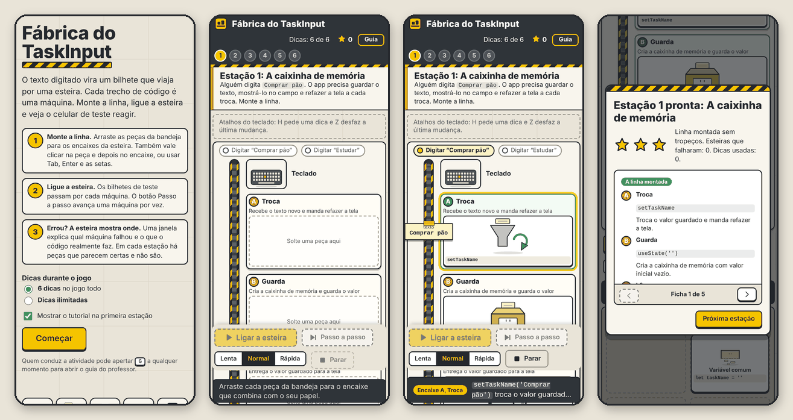
</p>

---

## Estrutura do projeto

```text
.
├── index.html        Estrutura das telas (início, jogo, final) e ordem dos scripts
├── estilos.css       Todo o visual: tokens de cor, escala, layout, animações e impressão
├── dados.js          Todo o conteúdo: estações, encaixes, peças, pacotes, dicas, fichas e guia
├── maquinas.js       As 34 ilustrações SVG das máquinas e os ícones da interface
├── visor.js          O celular de teste que fica ao lado da esteira
├── motor.js          A simulação: o que acontece quando cada pacote passa pelos encaixes
├── jogo.js           A tela e o estado: montagem, esteira, dicas, tutorial, janelas e pontuação
├── testes/
│   └── verificar.js  Confere os dados e testa todas as montagens possíveis (Node, sem dependências)
├── imagens/          Capturas de tela, GIF e colagens usadas neste README
├── package.json      Atalho para rodar o teste com npm test
└── README.md
```

| Arquivo | Linhas | Tamanho |
|---|---|---|
| `jogo.js` | 1613 | 57 KB |
| `estilos.css` | 2652 | 52 KB |
| `dados.js` | 807 | 42 KB |
| `maquinas.js` | 407 | 20 KB |
| `motor.js` | 488 | 17 KB |
| `visor.js` | 147 | 5 KB |
| `index.html` | 136 | 6 KB |

---

## Como funciona por dentro

Os scripts são clássicos e se comunicam por objetos globais em `window`. Por isso o jogo abre direto do disco (`file://`), onde módulos ES são bloqueados pelo navegador.

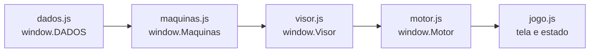

O `index.html` carrega os cinco scripts nesta ordem, e o `jogo.js` usa os quatro anteriores.

- **`dados.js`** guarda só dados. Nada ali mexe na tela.
- **`motor.js`** recebe a estação e a montagem (`{ idDoEncaixe: idDaPeça }`) e devolve, para cada pacote de teste, a lista de passos que a tela vai animar. Cada passo traz a legenda e o **estado completo do celular** depois dele. O motor também funciona em Node, o que permite testá-lo sem navegador.
- **`visor.js`** só desenha o celular. Quem decide o que aparece nele é o motor.
- **`jogo.js`** cuida de tudo que é interação: arrastar, clicar, teclado, animação do bilhete, dicas, tutorial, janelas, estrelas e a tela final.

A regra de sucesso é uma só: a estação fecha quando **todos** os pacotes de teste (menos os de observação) chegam certos. Nos testes, apenas a montagem do gabarito passa.

---

## Como personalizar

**O que dá para mudar só editando dados e estilo**

| Quero mudar | Onde |
|---|---|
| Textos, pedidos, dicas, fichas, guia do professor | `dados.js` |
| Peças, rótulos e código mostrado nas peças | `dados.js`, na lista `pecas` da estação |
| Pacotes de teste | `dados.js`, na lista `pacotes` da estação |
| Quantidade de dicas do jogo todo | `dicasPadrao` em `dados.js` (hoje, 6) |
| Cores e escala | variáveis em `:root` no começo de `estilos.css` |
| Velocidade das três opções de esteira | objeto `DUR` em `jogo.js` |
| Desenho de uma máquina | `maquinas.js` (quadro SVG de 120 por 90) |

Nos textos, `` `assim` `` vira trecho de código.

**Esquema de uma estação em `dados.js`**

| Campo | Para que serve |
|---|---|
| `id` | Liga a estação à função de mesmo nome em `motor.js` |
| `nome`, `cor`, `pedido` | Título, cor de destaque e enunciado |
| `origem`, `destino` | De onde o bilhete sai e onde chega: `{ rotulo, maq }` |
| `slots` | Encaixes, na ordem em que o bilhete passa: `id`, `papel`, `curto`, `certo` (id da peça certa) e `ok` (legenda quando o bilhete passa; `{t}` é o texto do pacote) |
| `pecas` | Bandeja: `id`, `tipo` (`certa`, `alternativa` ou `armadilha`), `rotulo`, `codigo`, `maq`, `faz`, `resumo`, `dica`, `dicaForte`, `pistaErro`, `flash` e, nas que enganam, `falhaPropria` |
| `pacotes` | Bilhetes de teste: `id`, `evento`, `texto`, `rotulo` e, se for só observação, `observar: true` |
| `celular0` | Estado inicial do celular de teste |
| `mostrarEspacos` | Mostra os espaços das pontas como pontinhos |
| `grupos` | Nomes de arquivos para agrupar os encaixes (cada encaixe indica o seu `grupo`) |

**Para criar uma estação nova** são quatro passos, porque o comportamento de cada estação vive em código:

1. Acrescente o objeto da estação em `DADOS.estacoes`, em `dados.js`.
2. Escreva em `motor.js` uma função `ESTACOES.<id>` que diga como um pacote percorre os encaixes. Ela usa os métodos do contexto: `origem`, `slotOk`, `slotPula`, `falhar` e `destino`. Como exemplo, a estação 1 inteira:

   ```js
   ESTACOES.memoria = function (c) {
     var s = c.slots;
     var t = c.pk.texto;
     c.origem("O teclado manda o texto digitado: `" + t + "`.");
     if (!c.slotOk(s[0])) return;
     if (!c.slotOk(s[1])) return;
     if (!c.slotOk(s[2], { texto: t, refeitas: c.cel.refeitas + 1 })) return;
     c.destino("O campo do celular mostra `" + t + "` e a tela foi refeita.");
   };
   ```

3. Se precisar de máquinas novas, desenhe-as em `maquinas.js` e use o nome delas no campo `maq`.
4. Acrescente a nota que aparece sob o celular em `NOTAS_LADO`, em `jogo.js`, e rode `npm test` para conferir os dados e as montagens.

---

## Testes e qualidade

**Incluído no repositório**

```bash
npm test
# ou, sem npm:
node testes/verificar.js
```

O script precisa só do Node. Ele confere se os dados de cada estação estão completos e coerentes e depois **testa todas as formas de encaixar as peças** nos encaixes: 324 montagens no total (24, 24, 12, 24, 120 e 120, uma contagem por estação). Para cada estação, exige que exatamente uma montagem, a do gabarito, conclua a estação, e que toda falha traga título, explicação e pista.

**Verificado durante o desenvolvimento**

Estas verificações foram feitas com o jogo aberto no Chromium e automação de navegador. Os scripts não fazem parte do repositório.

- Partidas completas das seis estações por arrastar, por clique e por teclado, com tutorial e sem tutorial, com dicas limitadas e ilimitadas.
- Erro de console e requisições externas: nenhum em toda a partida.
- Movimento reduzido, desfazer, devolver peça, passo a passo, janela de erro, fichas, tela final e impressão da cola.
- Layout nas telas abaixo.

| Tela | Resultado |
|---|---|
| 1280x720, 1366x768, 1366x657, 1920x1080, 2560x1440, 1280x1024, 1180x820, 1133x744, 1100x700 | Tudo cabe, sem rolagem |
| 1280x600 | Rola de 6 a 14 px |
| 1024x768, 900x700, 820x1180, 390x844, 844x390 | Layout vertical, sem rolagem horizontal e sem código cortado |

**Para contribuir**

Sugestões e correções são bem-vindas por *issue* ou *pull request*. Antes de enviar uma mudança em `dados.js` ou `motor.js`, rode `npm test`.

---

## Limites conhecidos

- **O celular de teste é uma simulação.** Ela reproduz o que foi medido na versão web do app (`react-native-web`). A caixa de alerta nativa do celular, o teclado virtual e o efeito de opacidade no toque real **não foram testados** em celular real, emulador ou Expo Go.
- **`Alert.alert` na web é uma função vazia.** O celular do jogo desenha os alertas por finalidade didática. A exceção é o teste do navegador da estação 4, que mostra justamente que nenhuma caixa aparece.
- **`trim()` não remove tudo que é invisível.** Ele tira espaços, tabs, quebras de linha e espaço sem quebra, mas não o espaço de largura zero (U+200B), que passa pela validação.
- **`Alert.alert` não bloqueia a execução.** A linha seguinte roda sem esperar o OK, por isso o campo já está limpo quando o alerta aparece.
- **`TouchableOpacity` e `Pressable`.** A documentação não marca o `TouchableOpacity` como obsoleto, mas recomenda o `Pressable` como opção mais completa. O jogo usa o `TouchableOpacity` porque é ele que esmaece ao toque sem estilo extra.
- **Sem leitor de tela real.** Os anúncios `aria-live` existem, mas o jogo não foi testado com NVDA, VoiceOver ou TalkBack.
- **Um navegador testado.** Só o Chromium foi usado nos testes.
- **Nada é salvo.** O jogo não grava dados no navegador. Recarregar a página volta ao início.

---

## Autoria

Criado por **Alexandre**, professor do IFF Campus Maricá, para o Curso Técnico em Informática para Internet.
